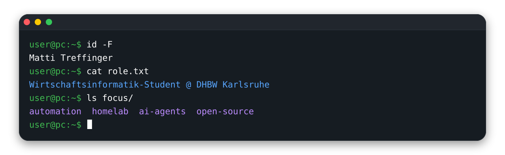

  

  
  

---

## 👋 Über mich

Ich bin ausgebildeter Fachinformatiker für Systemintegration und studiere aktuell Wirtschaftsinformatik mit dem Schwerpunkt Software Engineering an der DHBW Karlsruhe.
Beruflich gehört die Automatisierung betrieblicher Prozesse zu meinen Aufgaben und Spezialgebieten.
Privat bin ich begeisterter Open-Source-Entwickler und beschäftige mich viel mit KI und Infrastruktur.

## 🛠️ Tech-Stack

**Sprachen** 

**Infrastruktur & Ops** 

**Identity & Microsoft-Systeme** 

**KI-Agenten** 

## 🚀 Meine Projekte

<table>
<tr>
<td width="50%" valign="top">

### [CheckMCP](https://github.com/treffinger/CheckMCP)

CheckMCP ist ein MCP-Server, der KI-Agenten den Zugriff auf das Monitoringsystem Checkmk ermöglicht.
Der Server ist in Python geschrieben und kann als Container betrieben werden.

</td>
<td width="50%" valign="top">

### [edifactlib](https://github.com/treffinger/edifactlib)

edifactlib ist eine Python-Bibliothek zum Parsen, Validieren und Verarbeiten von EDIFACT-Interchanges.
Zudem bringt das Paket ein eigenes CLI-Tool mit, das EDIFACT-Interchanges formatiert in der Konsole anzeigen kann.
Installieren lässt sich edifactlib über pip: `pip install edifactlib`

</td>
</tr>
</table>

## 🏠 Homelab

Seit Jahren betreibe ich privat ein Homelab, das Dienste wie meine Nextcloud, GitLab, Checkmk oder TrueNAS bereitstellt.
Das meiste läuft auf einem Proxmox-VE-Host, nur der Fileserver und Checkmk haben eigene Server.
Alle Dienste sind an meine private Domäne angebunden, die Benutzer und Gruppen zentral bereitstellt.
Für mich ist das Homelab nicht nur ein Hobby, sondern auch eine Spielwiese, um mein Wissen über IT-Systeme zu vertiefen.

## 📫 Kontakt

Bei Fragen oder für eine Zusammenarbeit bin ich gerne erreichbar:
- **E-Mail:** matti@matti-treffinger.de
- **Matrix:** @matti.treffinger:matrix.org
